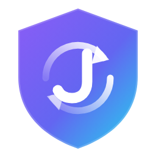
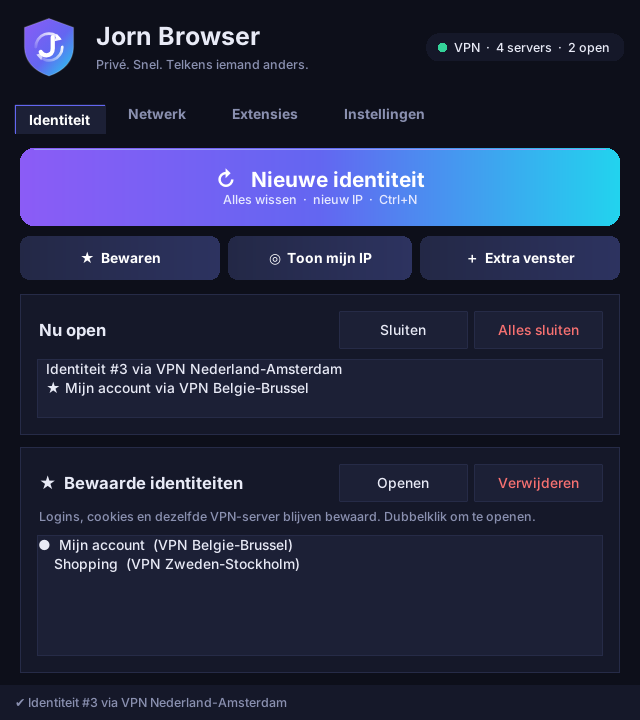

<p align="center"></p>

<h1 align="center">Jorn Browser</h1>
<p align="center"><i>Privé. Snel. Telkens iemand anders.</i></p>

<p align="center"></p>

Een snelle privacybrowser voor Windows met **Chrome-extensies** en een knop
**"Nieuwe identiteit"**, zoals in Tor Browser, maar veel sneller.

Jorn Browser is een venster rond **Chromium** (de open-source basis van Chrome).
Elke identiteit is een Chromium-venster met een **gloednieuw, tijdelijk profiel**.
Bij "Nieuwe identiteit" (of Ctrl+N) gebeurt dit binnen 1 à 2 seconden:

1. Alle vensters sluiten.
2. Cookies, cache, geschiedenis en logins worden gewist.
3. Er start een vers venster via een **andere VPN-server**, dus met een ander IP.

Ook inbegrepen:

- **Chrome-extensies**: plak een link uit de Chrome Web Store, klaar.
- **WebRTC-lekbescherming**: websites kunnen je echte IP niet zien buiten de VPN om.
- **Meerdere identiteiten tegelijk**, elk in een apart venster met een eigen IP.
- Alles wordt gewist bij het sluiten, en restjes na een crash bij de volgende start.

## Installatie (Windows)

1. **Chromium installeren**: open PowerShell en typ
   ```
   winget install eloston.ungoogled-chromium
   ```
   (gewone Google Chrome werkt niet: die laadt geen extensies via de app).
2. **JornBrowser.exe downloaden**: GitHub, tabblad *Actions*, laatste geslaagde
   build "Windows .exe bouwen", onderaan *Artifacts*, dan `JornBrowser-windows`.
   Of makkelijker: neem `JornBrowser.exe` van de pagina
   [Releases](https://github.com/Jornduthoo/Jorn-browser/releases/latest).
   Zet het bestand in een eigen map, bv. `C:\JornBrowser\`.
3. Dubbelklik. Windows SmartScreen kan waarschuwen omdat de exe niet
   ondertekend is: kies *Meer info*, dan *Toch uitvoeren*.

**Updates:** daarna hoef je niets meer te downloaden. Is er een nieuwe versie,
dan verschijnt bovenaan in de app een balk **Nu bijwerken**. Eén klik en de app
downloadt de update, controleert de checksum en herstart. Je instellingen blijven
staan. Onderaan rechts staat je versienummer en de knop *Updates zoeken*.
(Uitzetten kan in *Instellingen*. Het controleren gebeurt rechtstreeks bij GitHub,
dus buiten de VPN om.)

Heb je Python? Dan kan je ook gewoon `jornbrowser.pyw` dubbelklikken.

## 💾 Identiteit bewaren

Wil je een identiteit houden, bijvoorbeeld omdat je ergens ingelogd bent?
Klik op **💾 Bewaren** (of Ctrl+S) en geef ze een naam. Dan gebeurt dit:

- Logins, cookies, instellingen en open tabbladen worden onthouden.
- Ook de **VPN-server** wordt onthouden, dus je komt later terug met hetzelfde IP.
  Is die server bezet of werkt hij niet, dan neemt Jorn Browser een andere.
- Je kunt in hetzelfde venster gewoon verder.

Bewaarde identiteiten staan onderaan in het hoofdtabblad: **dubbelklik** om
er een te openen. "Nieuwe identiteit" raakt ze nooit aan, die wist alleen
de tijdelijke identiteiten. Verwijderen wist alles van die identiteit.

Bewaarde identiteiten staan in `data\identities\` op je eigen pc.

## Bladwijzers

Je bladwijzers worden **onthouden en gedeeld door alle identiteiten**, ook
door de tijdelijke. De bladwijzerbalk staat altijd aan.
- Elke nieuwe identiteit start met je centrale bladwijzerlijst (`data\bookmarks\`).
- Sluit je een venster, dan gaan je nieuwe of gewijzigde bladwijzers terug naar die lijst.
- Heb je twee vensters tegelijk open, dan worden nieuwe bladwijzers van beide samengevoegd.

## Ingebouwde VPN: geen VPN-app nodig

Jorn Browser heeft een ingebouwde VPN (WireGuard, via
[wireproxy](https://github.com/whyvl/wireproxy)). Je hoeft je VPN-app niet te
openen en er is geen installatie of adminrecht nodig. Elke identiteit krijgt
haar **eigen VPN-server**:

- Elke "Nieuwe identiteit" geeft een andere server, dus een ander IP, binnen ongeveer 1 seconde.
- Extra identiteiten draaien tegelijk, elk via een andere server.
- **Alleen Jorn Browser** gaat door de VPN, de rest van je pc niet.
- Valt de VPN weg, dan kan de browser nergens heen. Je echte IP lekt niet.
- DNS-opvragingen gaan ook door de VPN.

Werkt een server niet, dan probeert Jorn Browser automatisch de volgende.

### Je VPN-servers toevoegen (eenmalig)

Je hebt per server één **WireGuard-bestand** (`.conf`) nodig van je VPN-dienst.

**VPN Unlimited (KeepSolid):**
1. Log in op je account op de website van VPN Unlimited (KeepSolid User Office).
2. Kies bij je VPN Unlimited-abonnement de optie **handmatige configuratie**
   (*Manual configuration*).
3. Kies het protocol **WireGuard** en een server (bv. België), maak de
   configuratie aan en download het `.conf`-bestand.
4. Herhaal dat voor een paar landen of servers.

Niet elke VPN Unlimited-versie biedt WireGuard-bestanden aan. Zie je alleen
OpenVPN of IKEv2, dan werkt het daar niet mee. Let ook op: elke configuratie
kan een "apparaat" van je abonnement kosten.

**Mullvad / ProtonVPN:** op hun website maak je in een paar klikken
WireGuard-bestanden aan, voor veel servers tegelijk (als .zip).

Daarna in Jorn Browser: ga naar het tabblad **Netwerk**, kies **Ingebouwde VPN**,
klik op **VPN-bestanden toevoegen…** en selecteer je `.conf`-bestanden (of de `.zip`).
De bestandsnaam wordt de naam van de server, bv. `Belgie.conf`.

Je privésleutels blijven alleen op je eigen pc, in `data\vpn\`. Deel die map niet.

### Andere manieren
- **Proxylijst** (`proxies.txt`): eigen SOCKS5/HTTP-proxies, of klik op
  "Mullvad-lijst ophalen" terwijl de Mullvad-app verbonden is.
- **Geen:** een aparte VPN-app op je pc bepaalt het IP.

## Eerlijk over privacy

- **Sneller dan Tor** betekent dat je de VPN-aanbieder vertrouwt (1 tussenstap
  in plaats van 3). Kies er een die geen logs bijhoudt.
- **Extensies maken je herkenbaarder** (fingerprinting). Gebruik er zo weinig
  mogelijk. Een adblocker zoals uBlock Origin Lite is wel aan te raden.
- Je IP en cookies zijn telkens nieuw, maar je scherm, lettertypes en
  tijdzone blijven dezelfde. Tegen echt gerichte tracking is Tor Browser sterker.

## Mappen

| Wat | Waar |
|---|---|
| Instellingen, VPN-bestanden, `proxies.txt`, extensies | `data\` naast JornBrowser.exe |
| Bewaarde identiteiten | `data\identities\` |
| Bladwijzers (gedeeld) | `data\bookmarks\` |
| Tijdelijke profielen (worden gewist) | `%TEMP%\JornBrowser\profiles` |
